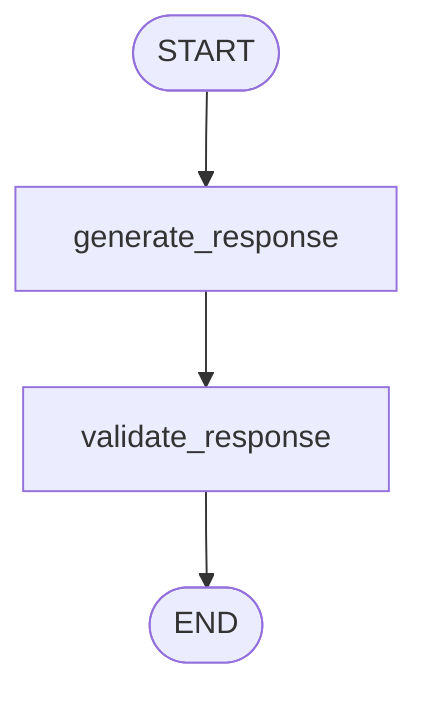

# Netsol API

A backend API built with **FastAPI, PostgreSQL, SQLAlchemy, and LangGraph**. The project provides user authentication, JWT-based authorization, user-owned chat threads, persistent conversation history, thread-aware conversational memory, and an AI-powered chat workflow.

## Features

- RESTful API built with FastAPI
- User registration and login
- JWT-based bearer authentication
- Protected user endpoints
- PostgreSQL database integration
- Asynchronous SQLAlchemy 2.x
- Database migrations using Alembic
- User-owned chat thread management
- Create, list, archive, restore, and delete chat threads
- Persistent user and assistant messages
- Conversation history with pagination
- Thread-aware conversational memory
- Bounded conversation context using token counting
- PostgreSQL-backed LangGraph checkpoint persistence
- Recovery from missing graph checkpoints using database history
- Checkpoint cleanup when deleting threads
- Google Gemini integration through a provider-independent LLM service
- LangGraph-based response generation and validation workflow
- Dependency injection for services and graph execution
- Centralized application error handling
- Automated tests using pytest

## Tech Stack

| Technology | Purpose |
|---|---|
| Python | Backend programming language |
| FastAPI | REST API framework |
| PostgreSQL | Relational database and checkpoint storage |
| SQLAlchemy 2.x | Async ORM |
| Alembic | Database migrations |
| Pydantic | Request and response validation |
| JWT | Authentication |
| Google Gemini | LLM provider |
| LangGraph | AI workflow orchestration and checkpointing |
| langgraph-checkpoint-postgres | Persistent graph checkpoint storage |
| psycopg | PostgreSQL connection for LangGraph checkpointing |
| pytest | Automated testing |
| uv | Python dependency management |

## Project Structure

```text
Netsol/
│
├── alembic/
│   └── versions/
│
├── src/
│   └── netsol/
│       ├── api/
│       │   ├── dependencies.py
│       │   └── v1/
│       │       ├── auth.py
│       │       ├── chat.py
│       │       ├── messages.py
│       │       ├── threads.py
│       │       ├── thread_messages.py
│       │       ├── users.py
│       │       └── router.py
│       │
│       ├── core/
│       │   ├── config.py
│       │   └── exceptions.py
│       │
│       ├── db/
│       │   ├── models/
│       │   └── session.py
│       │
│       ├── graphs/
│       │   ├── __init__.py
│       │   ├── builder.py
│       │   ├── nodes.py
│       │   └── state.py
│       │
│       ├── repositories/
│       ├── schemas/
│       ├── services/
│       │   ├── context.py
│       │   ├── conversation.py
│       │   └── thread.py
│       └── app.py
│
├── test/
├── .env.example
├── alembic.ini
├── pyproject.toml
├── uv.lock
└── README.md
```

## Setup and Installation

### 1. Clone the repository

```bash
git clone <repository-url>
cd Netsol
```

### 2. Install dependencies

Install `uv` if it is not already installed, then run:

```bash
uv sync --frozen
```

### 3. Configure environment variables

Create a `.env` file using `.env.example` as a template.

Configure the required:

- Application database connection
- Checkpoint database connection
- JWT settings
- Gemini API key
- LLM and conversation context settings

The application database uses an asynchronous SQLAlchemy connection.

The checkpoint database uses a PostgreSQL connection supported by `psycopg`.

For example, the checkpoint connection uses the `CHECKPOINT_DATABASE_URL` setting.

Do not commit your actual `.env` file or expose API keys.

### 4. Configure PostgreSQL

Make sure PostgreSQL is running and the databases specified in your environment configuration exist.

The application database stores users, threads, and messages.

The checkpoint database stores LangGraph execution snapshots. It can use a separate database on the same PostgreSQL server.

### 5. Run database migrations

```bash
uv run alembic upgrade head
```

Alembic manages the application database schema.

LangGraph checkpoint tables are initialized separately through the checkpointer's setup process during application startup.

### 6. Start the development server

```bash
uv run uvicorn netsol.app:app --reload --app-dir src
```

The API will be available at:

`http://127.0.0.1:8000`

Interactive API documentation:

`http://127.0.0.1:8000/docs`

## API Overview

| Area | Functionality |
|---|---|
| Health | Application health check |
| Authentication | User registration and login |
| Users | Retrieve authenticated user information |
| Messages | Basic message CRUD operations |
| Chat | AI-powered chat endpoint |
| Threads | Create, list, archive, restore, and delete chat threads |
| Thread Messages | Send messages and retrieve conversation history |

### Thread and Conversation Endpoints

| Method | Endpoint | Description |
|---|---|---|
| POST | `/api/v1/threads` | Create a chat thread |
| GET | `/api/v1/threads` | List the authenticated user's threads |
| GET | `/api/v1/threads/{thread_id}` | Retrieve a thread |
| PATCH | `/api/v1/threads/{thread_id}` | Update title or archive status |
| DELETE | `/api/v1/threads/{thread_id}` | Delete a thread and its messages |
| POST | `/api/v1/threads/{thread_id}/messages` | Send a message and receive an AI response |
| GET | `/api/v1/threads/{thread_id}/messages` | Retrieve conversation history |

Protected endpoints require a valid JWT bearer token.

## LangGraph Chat Workflow

The AI response generation process is organized into a LangGraph workflow.

The workflow contains two nodes:

1. **generate_response:** Builds the prompt and calls the provider-independent `LLMService`.
2. **validate_response:** Checks that the generated answer contains visible text, normalizes whitespace, and enforces the configured maximum response length.

### Workflow Diagram



### Graph State

The graph uses a typed state containing:

- `context_messages`
- `user_message`
- `answer`
- `model`
- `input_tokens`
- `output_tokens`

The conversation context and current user message are supplied separately to avoid duplicating the current message in historical context.

### Graph Lifecycle

The graph is built and compiled during FastAPI application startup.

The application initializes an `AsyncPostgresSaver`, runs its setup process, and compiles the graph with the persistent checkpointer.

The compiled graph and checkpointer are stored in application state and accessed through dependency injection.

The conversation service invokes the graph asynchronously using `ainvoke()`.

## Thread-Aware Conversation Memory

Task 11 introduces thread-aware conversation memory using LangGraph checkpointing and PostgreSQL-backed conversation history.

The implementation separates two responsibilities:

1. **Conversation history:** PostgreSQL stores the complete user and assistant message history.
2. **Graph execution state:** LangGraph checkpoints preserve graph execution state and snapshots.

The application database remains the source of truth for conversational messages. Checkpoints do not replace the message history.

### Conversation Context Building

Before invoking LangGraph, the conversation service builds a bounded context from previous messages stored in PostgreSQL.

The context builder:

1. Retrieves recent messages for the authorized thread.
2. Keeps the current user message separate from historical context.
3. Counts tokens using the configured LLM service.
4. Accounts for the system prompt and current message.
5. Adds complete user-assistant exchanges while respecting the configured token budget.
6. Preserves chronological order when constructing the final context.

The context builder uses configurable message-count and token limits.

A safety margin is added to the token budget to reduce the risk of exceeding the model's context window.

If the system prompt and current message alone exceed the allowed context budget, the request is rejected rather than silently truncating the current message.

Historical messages are not deleted or modified when the context is trimmed.

### Persistent Checkpointing

The graph is compiled with a PostgreSQL-backed checkpointer.

Each application conversation uses a stable, namespaced LangGraph thread ID:

```python
graph_thread_id = f"chat:{owner_id}:{thread_id}"
```

This ID associates graph checkpoints with the authenticated user and their application thread.

The namespaced ID provides isolation between different users and conversations.

The checkpointer stores graph execution state independently of the application's message records.

### Checkpoint and Conversation Recovery

The application does not depend exclusively on checkpoint state to reconstruct conversational context.

When a request arrives, the context builder retrieves conversation history from PostgreSQL before graph execution.

Consequently, if a graph checkpoint is missing, the application can rebuild the conversation context using the persisted message history.

This makes PostgreSQL message history the recovery source for conversational context.

### Thread Deletion and Checkpoint Cleanup

When an authenticated user deletes a thread:

1. The application verifies thread ownership.
2. It constructs the corresponding namespaced graph thread ID.
3. The checkpointer's `adelete_thread()` method is called.
4. The application thread and its associated messages are deleted from the database.

This prevents successfully deleted conversations from leaving their associated graph checkpoints behind.

### Responsibilities Outside the Graph

The graph is responsible for AI response generation and validation.

The following responsibilities remain outside the graph:

- Authentication and authorization
- Chat thread ownership checks
- Archived thread validation
- Conversation history retrieval
- Context construction and token budgeting
- Database operations
- Message persistence
- Checkpoint lifecycle management
- HTTP request and response handling

This separation keeps the AI workflow independent of the API and application database layers.

## Conversation Persistence Flow

When a user sends a message:

1. The API authenticates the user.
2. The conversation service verifies thread ownership and archive status.
3. Previous conversation history is retrieved from PostgreSQL.
4. The context builder prepares bounded conversational context.
5. LangGraph is invoked using the stable namespaced thread ID.
6. The response is generated and validated.
7. The user message and assistant response are persisted together.
8. The thread's update timestamp is refreshed.

Both messages are saved within a database transaction. If generation or validation fails, no conversation messages are persisted.

Conversation history remains available through the paginated history endpoint.

## Error Handling

The application handles common failures, including:

- Invalid request data
- Authentication and authorization failures
- Missing or inaccessible threads
- Archived thread message submissions
- LLM provider unavailability
- LLM rate limiting
- Invalid AI responses
- Oversized conversation context
- Database operation failures

AI provider failures are handled through application-level exceptions rather than exposing provider-specific errors to API clients.

## Running Tests

Run the complete test suite:

```bash
uv run pytest -v
```

The tests cover:

- API functionality
- Authentication and authorization
- Thread creation, updates, and deletion
- Conversation message persistence
- Conversation history and pagination
- Database transaction rollback
- Archived thread behavior
- LangGraph workflow execution
- Context construction and token limits
- Recovery from missing graph checkpoints
- Checkpoint deletion and ownership protection

The graph tests use fake LLM services and in-memory checkpointing where appropriate, avoiding real external LLM API calls.

## Configuration

Application settings are managed through the configuration module and environment variables.

Important configuration includes:

- Application database connection
- Checkpoint database connection
- JWT authentication settings
- Gemini API key
- LLM model
- LLM request timeout
- Maximum input characters
- Maximum output tokens
- Maximum output characters
- Maximum conversation context tokens
- Maximum historical messages included in context

## Development Scope

The project is developed incrementally, with each task introducing a specific backend capability.

- **Task 10:** Introduced LangGraph for structured AI response generation and validation.
- **Task 11:** Introduced thread-aware conversational memory, PostgreSQL-backed graph checkpointing, bounded context construction, recovery from missing checkpoint state, and checkpoint cleanup during thread deletion.

The implementation intentionally keeps authentication, database persistence, and conversation context construction outside the graph.

## Future Improvements

- More advanced AI workflows
- Retrieval-Augmented Generation (RAG)
- Additional LLM providers
- Improved observability and logging
- Production deployment and containerization
- More advanced checkpoint lifecycle and recovery monitoring

---

**Project:** Netsol API  
**Framework:** FastAPI  
**Database:** PostgreSQL  
**AI Workflow:** LangGraph  
**LLM Provider:** Google Gemini